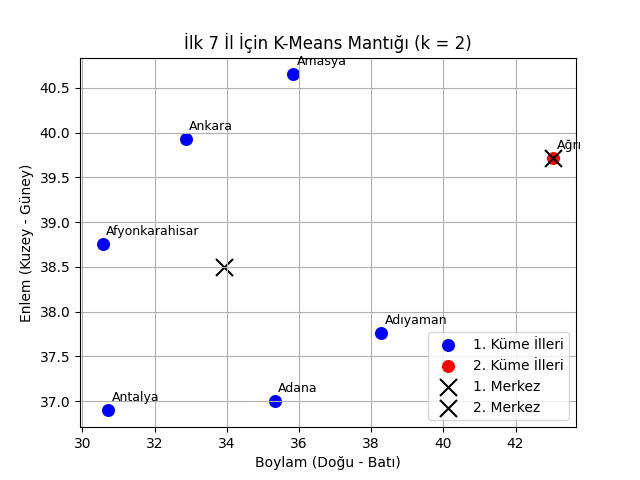
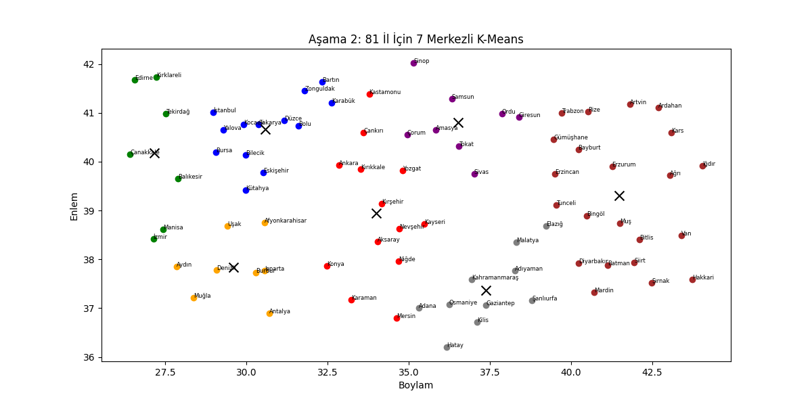
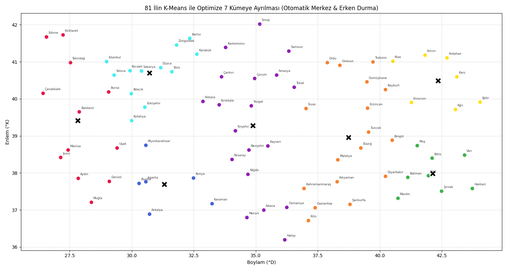

# Türkiye 81 İl K-Means Analizi

Bu çalışmada, denetimsiz öğrenme yöntemlerinden **K-Means Kümeleme** algoritması Türkiye'nin 81 ilinin coğrafi koordinatları üzerinde 3 farklı aşamada ele alınmıştır.

---

## 1. K-Means Aşamaları ve Coğrafi Bölge Karşılaştırması

* **Aşama 1 (`kmeans_asama1.py`):** İlk 7 il seçilerek $k=2$ küme merkezi ile Öklid mesafesi ve ağırlık merkezi güncelleme mantığı saf matematiksel adımlarla kurgulandı.
* **Aşama 2 (`kmeans_asama2.py`):** 81 ilin tamamı dahil edildi; elle seçilen 7 merkez üzerinden iller en yakın merkeze atanıp ağırlık merkezleri döngüyle güncellendi.
* **Aşama 3 (`kmeans_asama3.py`):** Başlangıç merkezlerini 81 il arasından rastgele seçen ve atamalar sabitlendiğinde (yakınsama) duran optimize algoritma uygulandı.

### "İller Gerçekten Bu Mantıkla mı Bölgelere Ayrılmış?"
* **K-Means:** Noktalar arasındaki kuş uçuşu doğrusal mesafeyi (Öklid) baz alır ve dairesel kümeler oluşturur.
* **Resmi 7 Coğrafi Bölge:** 1941 Coğrafya Kongresi'nde sadece koordinatlara göre değil; sıradağların uzanışı, denizellik/karasallık, yağış rejimi, iklim tipleri ve bitki örtüsü gibi fiziki/beşeri şartlara göre belirlenmiştir.
* **Sonuç:** K-Means doğu-batı hattında ince uzun uzanan Karadeniz veya Akdeniz gibi bölgeleri tek bir kümede toplayamaz; kıyı illerini dairesel yakınlıktan dolayı İç Anadolu merkezlerine bağlar. Dolayısıyla bölgeler salt koordinat mesafesiyle açıklanamaz.

---

## 2. Algoritma Çıktıları ve Harita Grafikleri

### 1. Aşama Çıktısı (İlk 7 İl, k=2)

### 2. Aşama Çıktısı (81 İl, k=7)

### 3. Aşama Çıktısı (81 İl Optimize K-Means)

